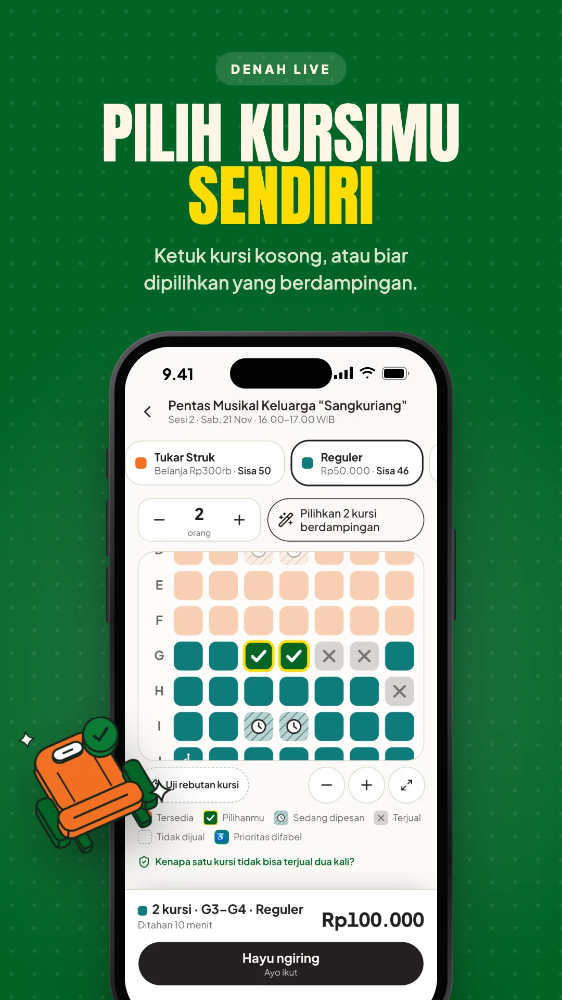
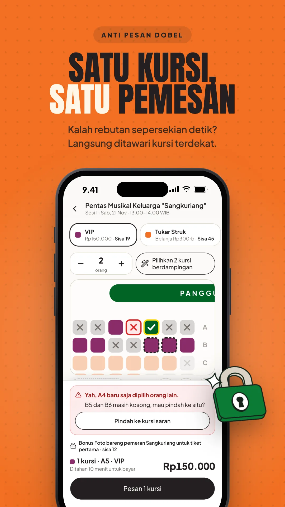
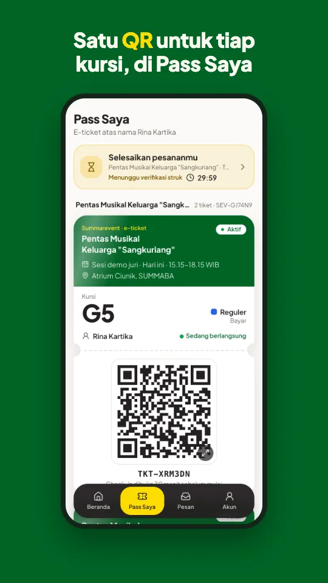
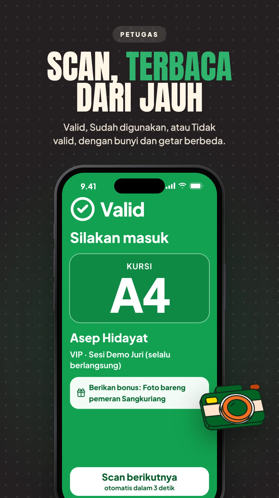
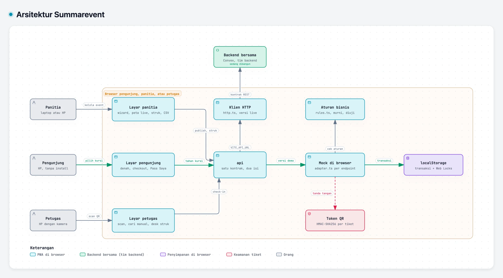

<!-- markdownlint-disable MD013 MD033 MD041 -->

<div align="center">


# Summarevent

**Satu pass untuk semua event Summarecon Mall Bandung.**

Pilih kursi langsung dari denah, lalu bayar, daftar gratis, atau tukar struk belanja.<br />
Semuanya berakhir di satu e-ticket QR, dibuka dari satu link, tanpa memasang aplikasi.

### [Coba di summarevent.vercel.app](https://summarevent.vercel.app)

[](https://summarevent.vercel.app)
[](https://github.com/Karsa-Swakarya-Loka/summarevent/actions/workflows/web.yml)
[](#gerbang-mutu)
[](#fitur)
[](https://react.dev)
[](https://vite.dev)
[](https://tailwindcss.com)

</div>

> [!NOTE]
> **Prototype untuk Bandung Build Challenge 2026**, tema *Event Ticketing System* dengan fokus pemilihan kursi.
> Versi demo jalan penuh di browser dengan data contoh, jadi tiap juri punya datanya sendiri. Versi live di [summarevent-live.vercel.app](https://summarevent-live.vercel.app) memakai backend bersama di Convex untuk uji dua HP. Pembayaran, OTP, WhatsApp, dan email disimulasikan di keduanya.

<p align="center">
  
  
  
  
</p>

## Kenapa Summarevent

Hari ini, masuk ke event SUMMABA bisa lewat banyak jalan: tiket di platform luar, akses lewat belanja, daftar di desk, dan struk di aplikasi mal. Pengunjung tidak tahu kursi mana yang tersisa, panitia mencatat denah, kuota, dan pembayaran di tempat terpisah, dan petugas mengecek tiket satu per satu di pintu. Summarevent menyatukannya di satu denah: cara mendapat tiket melekat di kategori kursinya, dan apa pun caranya, hasilnya satu e-ticket QR yang dicek dengan satu scan.

## Fitur

- **Denah yang terbaca tanpa menebak.** Warna menandai kategori, bentuk menandai status: tersedia, pilihanmu, sedang dipesan, terjual, tidak dijual, prioritas difabel. Memilih kategori membesarkan denah sampai tiap kursi jadi target sentuh 44 px, dan **Pilihkan N kursi berdampingan** memilih kursi terbaik dalam sekali ketuk.
- **Satu kursi, satu pemesan.** Semua kursi pesanan ditahan sekaligus atau tidak sama sekali, dengan hitung mundur 10 menit (30 menit untuk tukar struk). Yang kalah rebutan langsung mendapat saran kursi terdekat, bukan pesan error.
- **Tiga cara masuk di satu denah.** Bayar lewat QRIS atau Virtual Account, daftar gratis, atau tukar struk belanja di tenant SUMMABA dengan cek aturan otomatis dan baca struk dari foto (OCR di browser).
- **Checkout dua langkah.** Masuk dengan nomor HP, lalu bayar, kirim struk, atau konfirmasi gratis. Slip pesanan di atas, hitung mundur di app bar, dan tombol utama menempel di bawah. Tukar struk menampilkan meteran menuju belanja minimal dan cek syarat langsung.
- **E-ticket QR.** Tiap kursi dapat satu QR bertanda tangan, plus konfirmasi dan pengingat H-1 lewat WhatsApp dan email. Pass Saya berisi tiket hitam kecil, satu per kursi. Mengetuknya membuka tiket di layarnya sendiri, lengkap dengan talon (sobekan):
  - Tiket baru menyusun QR aslinya seperti sedang dibaca scanner, lalu tervalidasi garis hijau.
  - Setelah dipindai petugas, talonnya robek dan jatuh sendiri, seperti disobek di pintu masuk. Sebelum itu talonnya diam, jadi tiket yang masih berlaku tidak bisa tersobek tanpa sengaja.
  - Tiket bisa dibatalkan dengan refund sampai 24 jam sebelum sesi, dan nama peserta bisa diganti.
- **Panitia.** Dashboard dengan sidebar mengambang, pencarian ⌘K, dan pemilih event berbentuk pohon (event dan sesinya; sesi membuka peta kursi live): sesi dan kehadirannya, pendapatan dan tiket per hari, check-in per jam dengan sel yang bisa disorot, angka ringkas, dan pesanan terbaru dengan filter, halaman, dan aksi Tandai lunas. Lalu wizard event (info dan tema poster dengan warna pilihan panitia, kategori, denah dari template, sesi, publish), peta kursi live, pesanan dan peserta, verifikasi struk, unduh CSV, akun petugas, serta link dan poster QR untuk dibagikan.
- **Petugas.** Hasil scan Valid, Sudah digunakan, atau Tidak valid yang terbaca dari 1 meter, dengan bunyi dan getar berbeda. Ada cari tiket manual, check-in rombongan, dan verifikasi struk kertas di desk.
- **Daftar tunggu dan bonus.** Kategori yang habis menawarkan daftar tunggu dengan kabar otomatis, dan N pembeli pertama bisa mendapat bonus.
- **Sambutan yang bergerak, per role.** Splash menghidupkan logo Lorong: dua bloknya mengunci, lalu satu titik menyusuri lorong S. Splash muncul saat web dibuka, lalu sekali per sesi untuk tiap role yang dimasuki (Pengunjung, Panitia, Petugas) dengan nama rolenya, dan bisa diketuk untuk dilewati.
  - Tiap role punya pengenalan tiga langkah, sekali per HP.
  - Pengunjung **Masuk** atau **Daftar** dengan OTP simulasi yang bisa diisi otomatis.
  - Panitia dan petugas masuk dengan email dan kata sandi, lengkap dengan lupa kata sandi dan link reset sekali pakai (di versi demo link-nya tampil di layar; akun demonya bisa diisi otomatis). Petugas baru mendapat undangan ke emailnya untuk membuat kata sandi.
  - Ilustrasi isometrik bergerak mengisi layar kosong dan momen sukses. Semua gerak berhenti kalau HP diatur untuk mengurangi gerakan.
- **Terasa seperti aplikasi di HP.**
  - Layar yang dibuka bergeser masuk dari kanan, dan tombol kembali menggeser dari kiri.
  - App bar menempel di atas dengan judul besar yang mengecil saat di-scroll.
  - Dialog naik dari bawah sebagai sheet yang bisa ditarik turun.
  - Tab bar hanya ada di empat tab utama, dan tombol utama selalu dalam jangkauan jempol.
  - Beranda dibuka dengan panggung SUMMABA bergambar, kartu status, pintasan, dan sorotan yang bisa digeser. Akun berbentuk profil dengan baris pengaturan, dan foto, nama, serta email bisa diubah di Profil.
  - Pesan tampil seperti aplikasi chat: daftar pesan, lalu tiap WhatsApp atau email terbuka di layarnya sendiri.
  - Di Android, mengetuk kursi memberi getaran halus.
- **PWA.** Bisa dipasang di layar utama, dengan notifikasi perangkat selama app terbuka.

## Coba dalam dua menit

1. Buka [summarevent.vercel.app](https://summarevent.vercel.app), pilih **Pengunjung**, ikuti atau **Lewati** pengenalan tiga langkah, lalu pilih *Pentas Musikal Keluarga "Sangkuriang"* sesi 16.00.
2. Pilih **Reguler**, ketuk **Pilihkan 2 kursi berdampingan**, lalu **Pesan 2 kursi**. Kursinya ditahan 10 menit.
3. Masuk dengan nomor HP apa saja (kode OTP tampil di layar), lalu tekan **Bayar Rp100.000** (simulasi). Ketuk **Lihat e-ticket**.
4. Kembali ke denah dan tekan **Uji rebutan kursi**: pembeli simulasi menang sepersekian detik lebih dulu, dan kamu ditawari kursi terdekat.
5. Lewat tombol **Demo**, pindah langsung ke **Panitia** (verifikasi struk, peta kursi live, unduh CSV) dan **Petugas** (*Sesi Demo Juri* → **Mulai scan** → **Alat demo** → **Ambil tiket contoh**). Dari halaman awal, keduanya melewati splash, pengenalan, dan login email: tekan **Isi otomatis** untuk akun demonya.

**Reset data demo** di menu halaman awal mengembalikan semua data contoh. Di versi live, reset menghapus data bersama, jadi kabari tim dulu.

## Panduan tes tim

[`docs/PANDUAN-TES.md`](docs/PANDUAN-TES.md) berisi alamat, akun, dan data contoh untuk tes, lalu langkah tes sesuai tanggung jawab tiap orang:

| Siapa | Bagian | Isinya |
| --- | --- | --- |
| Shelvia | [User testing dan UX](docs/PANDUAN-TES.md#shelvia-user-testing-dan-ux) | Skrip sesi, 14 tugas untuk pengunjung, panitia, dan petugas, apa yang dicatat, dan cara melapor temuan |
| Said | [QA sistem](docs/PANDUAN-TES.md#said-qa-sistem) | Tes otomatis ke versi demo dan live, cek manual tiap aturan, dan format laporan bug |
| Awwal | [Demo dan pitch](docs/PANDUAN-TES.md#awwal-demo-dan-pitch) | Link untuk juri, alur demo lima menit, angka untuk slide, dan catatan untuk deck |

## Cara kerja

<sub>KODE → DIAGRAM · Peta sistem yang menaut ke baris kodenya</sub>

<a href="https://karsa-swakarya-loka.github.io/summarevent/arsitektur.html">
<picture>
  <source media="(prefers-color-scheme: dark)" srcset="docs/gambar/arsitektur-gelap.webp" />
  
</picture>
</a>

**[Buka diagram interaktif ↗](https://karsa-swakarya-loka.github.io/summarevent/arsitektur.html)** · [telusuri jalur pesan kursi ↗](https://karsa-swakarya-loka.github.io/summarevent/arsitektur.html#route=pengunjung~penyimpanan) · [sumber JSON](docs/arsitektur.archify.json)

- **Satu kontrak, dua implementasi.** Layar hanya memanggil `api`. Tanpa konfigurasi, `api` adalah mock di browser. Dengan `VITE_API_URL`, `api` memanggil backend lewat HTTP dengan kontrak yang sama persis, yang ditulis di [`docs/API-CONTRACT.md`](docs/API-CONTRACT.md) dan `src/api/contract.ts`.
- **Aturan bisnis murni.** Hold, kuota, aturan struk, check-in, dan transisi status ada di `src/domain/rules.ts` dengan unit test. Alur per endpoint ada di `src/api/mock/adapter.ts`, dan file itu jadi acuan port untuk backend.
- **Rebutan kursi tanpa server.** Setiap tulisan di mock berjalan dalam transaksi yang memegang Web Lock lintas tab. Dua tab yang menahan kursi yang sama di saat bersamaan dilayani bergiliran, dan hanya satu yang menang.
- **Satu kosakata status.** Label pesanan, kursi, dan tiket datang dari `src/domain/labels.ts`, jadi pengunjung, panitia, dan petugas membaca status yang sama persis.
- **QR yang tidak bisa ditebak.** Token berisi id tiket, versi, dan tanda tangan HMAC-SHA256. Di demo kuncinya ada di bundle karena datanya contoh; backend menandatanganinya di server.
- **Denah SVG.** Ringan di 4G, bisa digeser dan dicubit, dan tiap kursi adalah tombol berlabel ("Baris C nomor 8, Tukar Struk, tersedia") yang bisa dipilih dengan keyboard.

## Mulai lokal

Butuh Node.js 22.12 atau lebih baru (CI memakai 24), dan Google Chrome untuk suite end-to-end.

```sh
git clone https://github.com/Karsa-Swakarya-Loka/summarevent.git
cd summarevent/frontend
npm install        # sekalian mengaktifkan hook git
npm run dev        # http://localhost:5173
```

| Perintah | Fungsi |
| --- | --- |
| `npm run dev` | Server development, versi demo dengan data di browser |
| `npm run typecheck` | Cek tipe TypeScript |
| `npm run lint` | oxlint |
| `npm test` | Unit test logika inti (Vitest) |
| `npm run e2e` | Suite end-to-end dan aksesibilitas di Chrome, dengan `npm run dev` jalan di terminal lain ([detail](frontend/e2e/README.md)) |
| `npm run build` | Build produksi ke `dist/` |
| `npx knip` | Mencari file, export, dan dependency yang tidak terpakai |

Variabel saat build, semuanya opsional:

| Variabel | Fungsi |
| --- | --- |
| `VITE_API_URL` | Alamat backend. Kalau diisi, app memakai backend bersama, bukan mock di browser. |
| `VITE_LIVE_HOSTS` | Host yang otomatis memakai backend di `/api` host itu sendiri, dipisah koma. |
| `VITE_LIVE_URL` | Alamat versi live. Versi demo mengecek `/api/health`-nya dan menautkannya saat sehat. |
| `VITE_DEMO_URL` | Alamat versi demo untuk tautan balik dari versi live. Default `https://summarevent.vercel.app`. |

## Struktur

```text
summarevent/
├── frontend/
│   ├── src/
│   │   ├── api/            # kontrak, klien HTTP, mock di browser (data contoh + alur per endpoint)
│   │   ├── domain/         # tipe, aturan bisnis murni, label status, token QR
│   │   ├── components/     # denah kursi, komponen per peran, komponen dasar shadcn/ui
│   │   ├── pages/          # layar pengunjung, panitia, petugas, dan halaman pilih peran
│   │   ├── layouts/        # kerangka tiap peran
│   │   ├── hooks/, lib/    # data live, format, PWA
│   │   └── test/           # unit test Vitest
│   ├── e2e/                # suite end-to-end dan aksesibilitas (playwright-core + Chrome)
│   ├── public/             # ikon PWA, manifest, service worker, gambar pratinjau link, foto tim
│   └── scripts/            # screenshot cepat, gambar promo README, gambar pratinjau link, potong foto tim
├── backend/                # backend Convex untuk versi live (tim backend), mengikuti kontrak API
├── docs/                   # panduan tes tim, kontrak API, diagram arsitektur, brand kit, gambar README, lisensi
├── scripts/                # cek atribusi AI beserta tesnya
├── .githooks/              # commit-msg dan pre-push
└── AGENTS.md               # aturan kerja untuk manusia dan AI agent
```

## Gerbang mutu

| Lapis | Isi |
| --- | --- |
| **Web** (CI) | Typecheck, lint, unit test, dan build produksi di setiap PR dan push ke `main`. |
| **No AI attribution** (CI dan hook) | Menolak atribusi AI di commit dan PR. Juga dicek hook `commit-msg` dan `pre-push` ([aturannya](AGENTS.md#1-tanpa-atribusi-ai)). |
| **End-to-end** (lokal) | Alur nyata di Chrome: splash dan pengenalan pengunjung baru, daftar akun, bayar, tukar struk, gratis, rebutan kursi, waktu habis, daftar tunggu, refund, OCR, periode jual, panitia di laptop dan HP, wizard, dan petugas sampai pengunjung melihat "Terima kasih sudah datang". Suite gagal kalau hasilnya salah, ada error di console, atau layar bisa digeser ke samping. |
| **Aksesibilitas** (lokal) | axe-core memeriksa WCAG 2.1 AA di 58 layar ketiga peran, termasuk pengenalan dan login tiap role, lupa dan reset kata sandi, daftar, checkout, tiket, pesan, menu, dialog, dan form. Di HP 360 px setiap target sentuh minimal 44 px, kursi diukur setelah zoom. |

Perilaku baru disertai test: aturan di unit test, alur pengguna di end-to-end. Tampilan dicek di HP 360 px sampai desktop.

## Keamanan dan privasi

- **Data contoh saja.** Nama, nomor HP, tenant, pesanan, dan struk di demo semuanya fiktif, dan struk contoh bertanda "STRUK CONTOH". Tidak ada data kartu atau rekening yang diminta.
- **Tanpa server di versi demo.** Semua data tinggal di browser pengunjung dan hilang lewat **Reset data demo**.
- **Versi live untuk uji, bukan data asli.** Kode OTP dan akun demo masih tampil di layar, jadi siapa pun bisa masuk dengan nomor HP mana pun. Pakai nama dan nomor contoh. Sebelum dipakai sungguhan, OTP harus dikirim lewat WhatsApp atau SMS dan login demo dimatikan.
- **Tiket.** Tiap QR bertanda tangan, jadi QR palsu ditolak saat scan. Layar tiket mengingatkan agar foto QR tidak diunggah ke media sosial.
- **Foto.** Foto struk dan foto profil digambar ulang di browser sebelum dikirim, jadi data lokasi di dalam foto ikut terbuang.
- **Data pengunjung di sisi panitia.** Nomor HP di daftar pesanan disamarkan. Di CSV versi demo, isi yang diawali `=`, `+`, `-`, atau `@` diberi tanda petik di depannya supaya tidak dijalankan sebagai rumus di Excel atau Sheets. Backend menyusul dengan aturan yang sama.
- **HP petugas.** Data untuk scan offline menyimpan sidik SHA-256 tiap QR, bukan QR-nya, dan dihapus saat petugas keluar.
- **Header keamanan.** Halaman tidak bisa dibingkai situs lain, jenis berkas tidak ditebak browser, dan hanya kamera (untuk scanner petugas) yang boleh dipakai.
- **Tanpa pelacak.** Tidak ada cookie pelacak atau analitik pihak ketiga.

## Deploy

| Bagian | Di mana | Catatan |
| --- | --- | --- |
| Frontend | Vercel, folder `frontend/` | `vercel deploy --prod` dari `frontend/`. Satu deployment melayani dua host: [summarevent.vercel.app](https://summarevent.vercel.app) memakai mock di browser, dan [summarevent-live.vercel.app](https://summarevent-live.vercel.app) memakai backend lewat `/api` miliknya, yang diteruskan `vercel.json` ke Convex. Host live disebut di `VITE_LIVE_HOSTS` di `.env.production`. |
| Backend | Convex, dikelola tim backend | Di [`backend/`](backend/README.md), mengikuti [kontrak API](docs/API-CONTRACT.md). Frontend cukup di-build dengan `VITE_API_URL` yang menunjuk ke `https://<deployment>.convex.site/api`. |
| Diagram arsitektur | GitHub Pages dari `main` `/docs` | [karsa-swakarya-loka.github.io/summarevent/arsitektur.html](https://karsa-swakarya-loka.github.io/summarevent/arsitektur.html) |

## Dokumentasi

| Dokumen | Isi |
| --- | --- |
| [Panduan tes tim](docs/PANDUAN-TES.md) | Akun dan data contoh, lalu langkah tes untuk user testing (Shelvia), QA sistem (Said), serta demo dan pitch (Awwal) |
| [Kontrak API](docs/API-CONTRACT.md) | Endpoint, bentuk data, aturan yang wajib sama dengan mock, kode error, dan uji terima backend |
| [Diagram arsitektur](https://karsa-swakarya-loka.github.io/summarevent/arsitektur.html) | Peta sistem interaktif yang menaut ke baris kode. Sumbernya [`docs/arsitektur.archify.json`](docs/arsitektur.archify.json) |
| [Uji end-to-end](frontend/e2e/README.md) | Isi tiap suite, cara menjalankan, dan mode uji terima backend |
| [Frontend](frontend/README.md) | Skrip bantu: screenshot, gambar promo dan pratinjau link, knip |
| [Brand](docs/brand/README.md) | Logo, warna, dan aturan pakai |
| [Aturan kerja](AGENTS.md) | Pembagian kerja, tanpa atribusi AI, aturan frontend, cek sebelum commit |

Diagram dibuat dengan [Archify](https://github.com/tt-a1i/archify) 3.2 (MIT, [lisensi](docs/lisensi/archify-MIT.txt)). Untuk memperbaruinya, ubah `docs/arsitektur.archify.json` dan pin `meta.repository.revision` ke commit yang dikutip. Lalu jalankan `finalize` Archify dengan `--repo-root .`, salin `.archify/arsitektur.html` ke `docs/`, dan ekspor gambar terang serta gelap lewat menu **Ekspor → PNG**, lalu ubah ke WebP selebar 2400 px.

## Tim

Dibuat di Bandung oleh Tim Summarevent.

<table>
  <tr>
    <td align="center"><a href="https://github.com/HaikalFaruq"><br /><b>Muhammad Haikal Faruq</b></a><br /><sub>Frontend, lead teknis, desain</sub></td>
    <td align="center"><a href="https://github.com/bintangfabian"><br /><b>Bintang Fabian Putra</b></a><br /><sub>Backend</sub></td>
    <td align="center"><a href="https://github.com/shelviapramodita"><br /><b>Shelvia Pramodita</b></a><br /><sub>User testing, UX</sub></td>
    <td align="center"><a href="https://github.com/awwalakhalqin"><br /><b>Awwal</b></a><br /><sub>Product, business, pitch</sub></td>
    <td align="center"><a href="https://github.com/imsaidm"><br /><b>Said Mustaqim</b></a><br /><sub>System QA</sub></td>
  </tr>
</table>

Logo dan aturan pakainya ada di [`docs/brand`](docs/brand/README.md).

Ilustrasi bergerak memakai kit [fun-isometric](https://skills.klvn.dev/fun-isometric) karya Kelvin Adithya (MIT, [lisensi](docs/lisensi/fun-isometric-MIT.txt)), digambar dengan palet Summarecon. Tiket di Pass Saya diadaptasi dari «Talón» dan kipas poster di halaman depan dari «Afiche», keduanya karya [Moxen](https://moxen.cl/recursos) ([lisensi Talón](docs/lisensi/moxen-talon.txt), [lisensi Afiche](docs/lisensi/moxen-afiche.txt)). Judul memakai font [Anton](https://github.com/googlefonts/AntonFont) dan barcode tiket memakai [Libre Barcode 128 Text](https://github.com/graphicore/librebarcode), keduanya SIL Open Font License 1.1 ([Anton](docs/lisensi/anton-OFL.txt), [Libre Barcode](docs/lisensi/libre-barcode-128-OFL.txt)). Poster di slide Tim diadaptasi dari «Crumple Changelog» karya Kedhareswer, dengan huruf [Permanent Marker](https://fonts.google.com/specimen/Permanent+Marker) karya Font Diner (Apache 2.0, [lisensi](docs/lisensi/permanent-marker-Apache-2.0.txt)).
