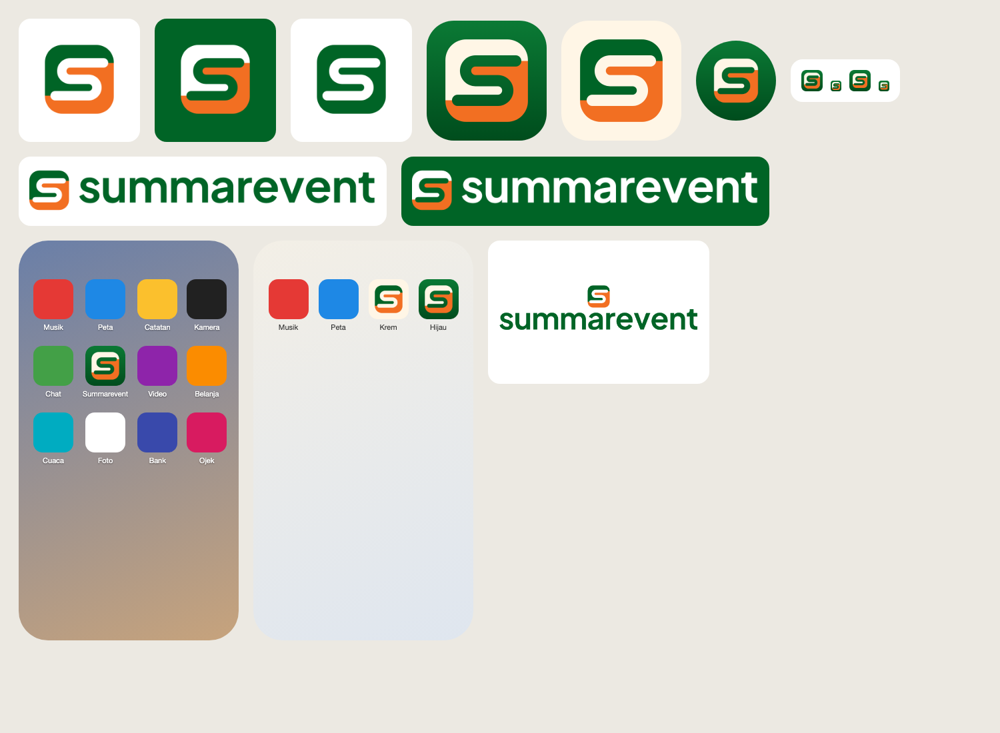

# Brand Summarevent

Logo **"Lorong"**: dua blok kursi, hijau dan oranye, dipisah lorong berbentuk S yang ujungnya membulat. Jalan menuju kursimu, sekaligus huruf S untuk Summarevent.

## File

Kit lengkap ada di [`final/`](final/), dibuat oleh [`final/generate_logo_kit.py`](final/generate_logo_kit.py). App hanya memuat yang dipakai, di `frontend/public/`:

| File | Pakai untuk |
| --- | --- |
| `brand/summarevent-symbol.svg` | Simbol di latar terang (hijau `#006426` + oranye `#F26F22`) |
| `brand/summarevent-lockup.svg` | Simbol + wordmark, latar terang |
| `brand/summarevent-lockup-white.svg` | Simbol + wordmark, latar hijau atau gelap |
| `brand/summarevent-app-icon.svg` | Ikon app (ubin hijau bergradasi halus, blok krem + oranye) |
| `brand/summaba-logo.png` | Logo resmi Summarecon Mall Bandung dari tim (431×98, latar transparan) |
| `favicon.svg`, `favicon.ico` | Tab browser: ubin dengan potongan kecil yang lorongnya lebih lebar |
| `apple-touch-icon.png`, `icon-192.png`, `icon-512.png`, `maskable-512.png` | Ikon PWA; versi maskable menaruh simbol di zona aman 80% |
| `og.png` | Gambar pratinjau link (1200×630) |

Varian lain di `final/`: simbol putih, satu warna, dan hitam, versi kecil, lockup tumpuk, wordmark, dan ikon app krem.

## Aturan pakai

- **Ruang kosong** minimal setinggi satu lorong (±14% tinggi simbol) di semua sisi.
- **Ukuran minimal** simbol 16 px (di bawah 24 px pakai versi kecil), lockup horizontal tinggi 20 px.
- **Warna** hijau `#006426`, oranye `#F26F22`, krem `#FFF6E6`. Kuning `#FEDC01` hanya untuk aksen UI. Hijau, kuning, dan merah status di app tidak dipakai di logo.
- **Jangan** memutar atau memiringkan simbol, menukar posisi warna blok, menambah bayangan atau efek (gradasi hanya di ubin ikon app), meregangkan proporsi, atau menaruh lockup hijau di latar hijau.
- **Wordmark** memakai Plus Jakarta Sans (SIL OFL) weight 680 yang sudah diubah jadi path, jadi tidak butuh font terpasang.
- **Logo SUMMABA** tidak boleh diwarnai ulang. Di latar hijau atau gelap, taruh di pelat putih (komponen `SummabaLogo tone="light"`).
